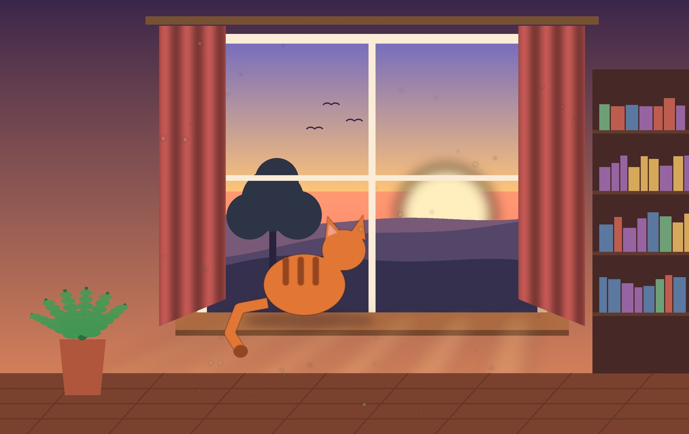
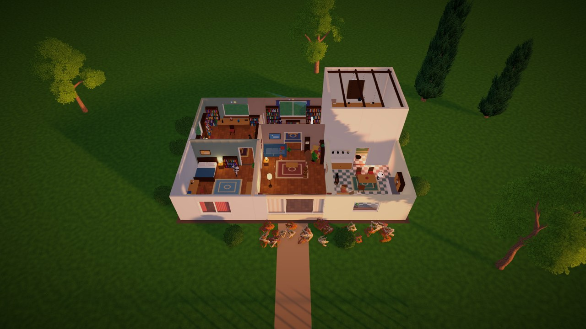
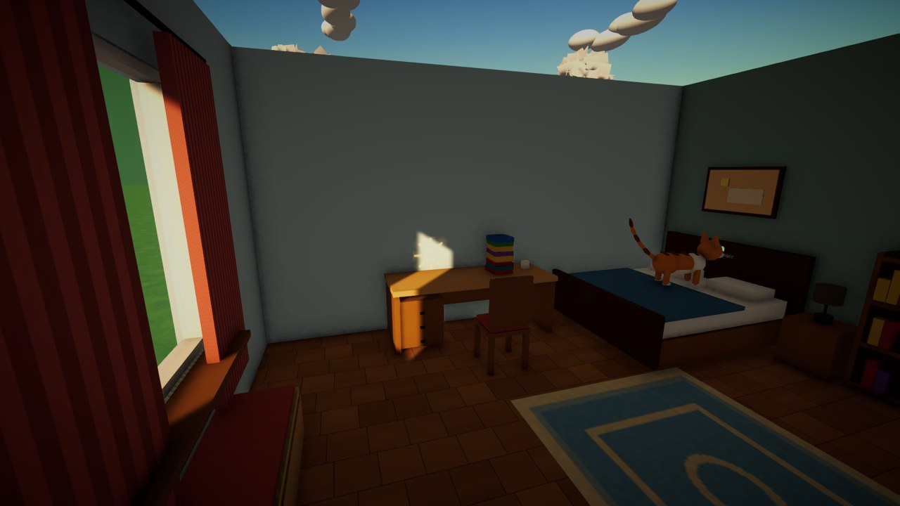
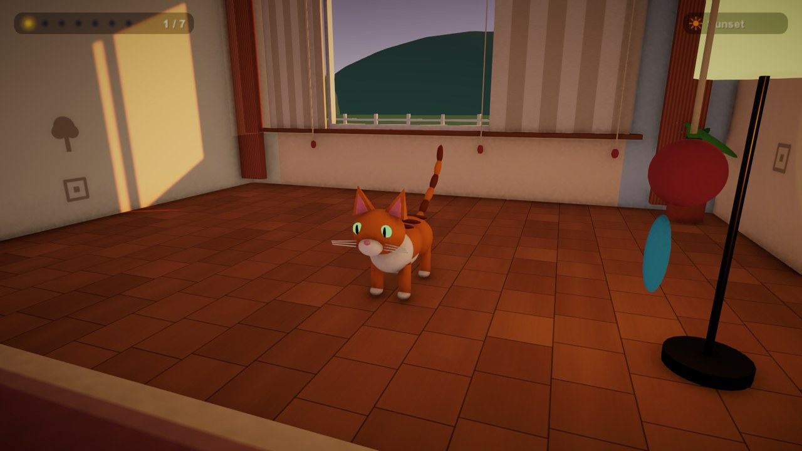
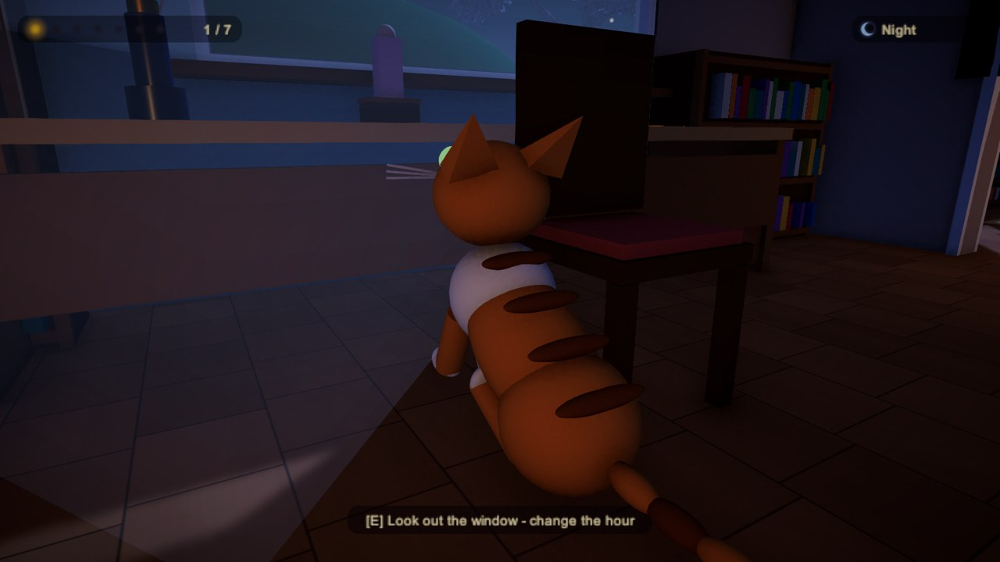
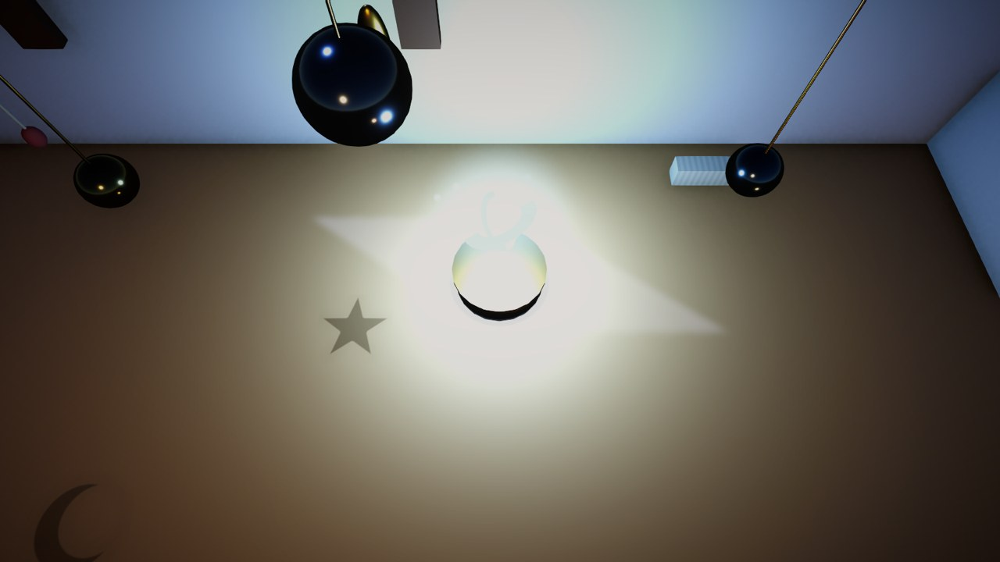
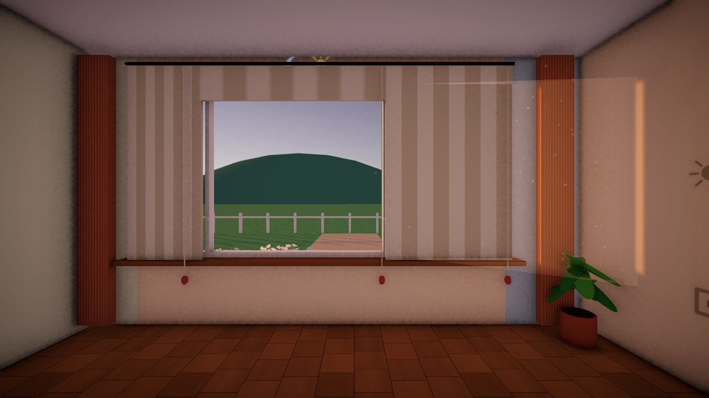
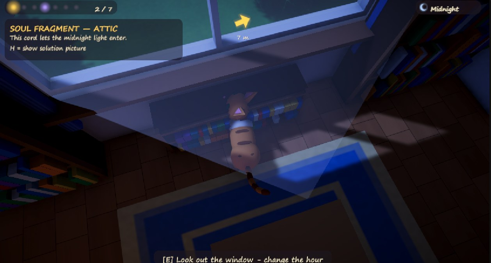

  

<h1 align="center">Cat's 7 Lives</h1>

<i>A cozy little 3D puzzle about windows, light and the hours of the day.</i>

---

## The story

One quiet morning, a falling star brushes past a small house and scatters the soul of **Miso**, an orange cat, into
**seven glowing fragments**. They hide in the seven rooms of the house, and each one holds a memory of being loved.

Miso has no words, only paws, a meow and a nose for light. She watches sunbeams slide across the walls and shadows
stretch as the day turns from sunrise to midnight. She pushes books, ferns and lamps into place, turns mirrors and
trays to bounce the light, tugs blind cords, and lets the right hour reveal what each room is hiding.

When the seventh fragment comes home, the house breathes out, the windows fill with golden sunrise, and Miso purrs on
the warm sill, home at last.

   
  The whole house: seven rooms, seven soul fragments.

## How it plays

- **Explore in any order.** Walk into a room, find what it wants, solve it, collect the glowing orb.
- **Light is the puzzle.** Sunbeams, shadows, reflections and moonlight change with the hour of the day.
- **Stuck? Press H.** A small picture shows the cat doing the next step. No walls of text.
- **Press M for the map.** It shows the rooms, where you are, and which fragments are still waiting.
- **Just a cat.** No enemies, no timers, no game over.

<table>
  <tr>
    <td> The Bedroom: move the books out of the sunbeam.</td>
    <td> The Living Room at sunset.</td>
  </tr>
  <tr>
    <td> The Study at night.</td>
    <td> The Attic: the moon fills the basin.</td>
  </tr>
  <tr>
    <td> Sunbeams with floating dust.</td>
    <td> The objective card and the guide arrow.</td>
  </tr>
</table>

## The seven rooms

| # | Room | Best hour | What it is about |
|---|------|-----------|------------------|
| 1 | Bedroom | Morning | Clear a sunbeam so it reaches the wall carving |
| 2 | Living Room | Sunset | Shadows of the fern and crates fill the floor marks |
| 3 | Kitchen | Morning | Bounce light off a silver tray onto the glass star |
| 4 | Study | Night | Bring the milk bottle to the saucer under the moon |
| 5 | Attic | Midnight | Open the shutters and set the moon basin on its ring |
| 6 | Sunroom | Sunrise | Turn the mirrors so the gold beam finds its target |
| 7 | Library | Any | Fern and lamp onto their marks to wake the sleeping cat carving |

## Controls

| Action | Keys |
|---|---|
| Move | `W` `A` `S` `D` |
| Look | Mouse |
| Run | Hold `Shift` |
| Jump and climb | `Space` |
| Paw at things, meow | `E` |
| Turn mirrors and trays | `E` / `Q` |
| Drag objects | Hold `F` |
| Hint picture | `H` |
| Map | `M` |
| Pause | `Esc` |

A gamepad works too.

## Run it

1. Open the project with **Unity 6000.3** (Universal Render Pipeline, Input System).
2. Open `Assets/Scenes/MainMenu` and press **Play**.
3. After changing the world code, run **Cat On The Sill > Bake All** from the Unity menu to rebuild the scenes.

## Built with Xorin

This game was built with the help of **Xorin**, an AI assistant for Unity that works directly with the editor.

- **Xorin sits inside the project.** It is installed as a Unity package (`com.xorin.brain`), so it can see what the
  editor sees: console messages, compile errors and warnings.
- **Scripts, scenes and UI were written with it.** The cat, the house, the light and shadow puzzles, the day and night
  system, the menus, the hint pictures and the map were all developed in conversation with Xorin, one request at a time.
- **Fast fixing.** When something broke, such as a missing script, a puzzle that would not solve, or a button that did
  not respond in the exported build, Xorin read the errors, found the cause in the code and fixed it.
- **Playtesting stayed human.** The author tried the game, shared screenshots and said what felt confusing, and Xorin
  turned that feedback into changes: clearer hints, a map, any-order puzzles, a friendlier menu.

## Credits

- Game design, playtesting and direction: the author.
- Code, scene building and UI: built with **Xorin**.
- Trees and scenery seen through the windows: low-poly models by [Quaternius](https://quaternius.com) (CC0).
- Everything else, including the cat, furniture, sounds and menus, is made in code.
